<h1 align="center">ambi.</h1>

<h3 align="center">A little less on your mind.</h3>

<p align="center">
  An ambient computer-use agent that keeps the context, offers a hand, and lets you keep your train of thought.<br>
  Voice · Local memory · Camera cues · Computer use
</p>

<p align="center">Built with OpenAI Realtime API, Decisions API, and Agents SDK with <code>gpt-6.1-terra</code>.</p>

<p align="center">
  <a href="#meet-ambi">Meet Ambi</a> ·
  <a href="#try-it-on-your-mac">Quickstart</a> ·
  <a href="eval/test/README.md">One-minute demo</a> ·
  <a href="docs/LOCAL-DEVELOPMENT.md">Developer guide</a>
</p>

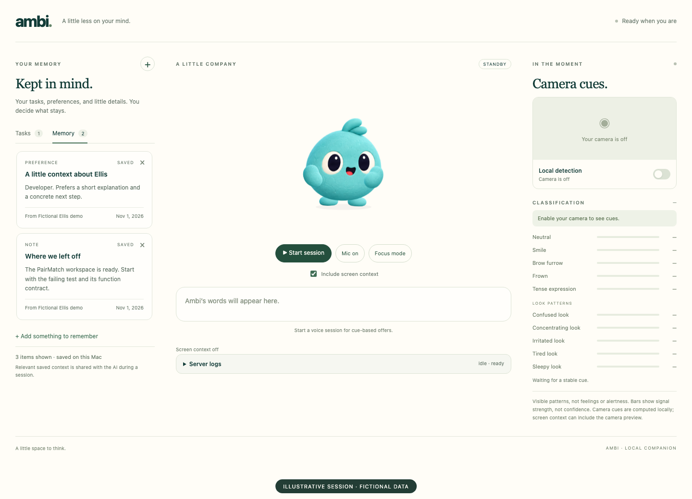

<p align="center"><em>The current demo frontend, captured locally with fictional Ellis context. Camera is off.</em></p>

## Meet Ambi in 30 seconds

Ambi is an **open-source AI agent started at the London Codex Community hackathon on 1 November 2026**. The working prototype brings OpenAI voice, local memory and visible computer actions together on Mac and Windows.

[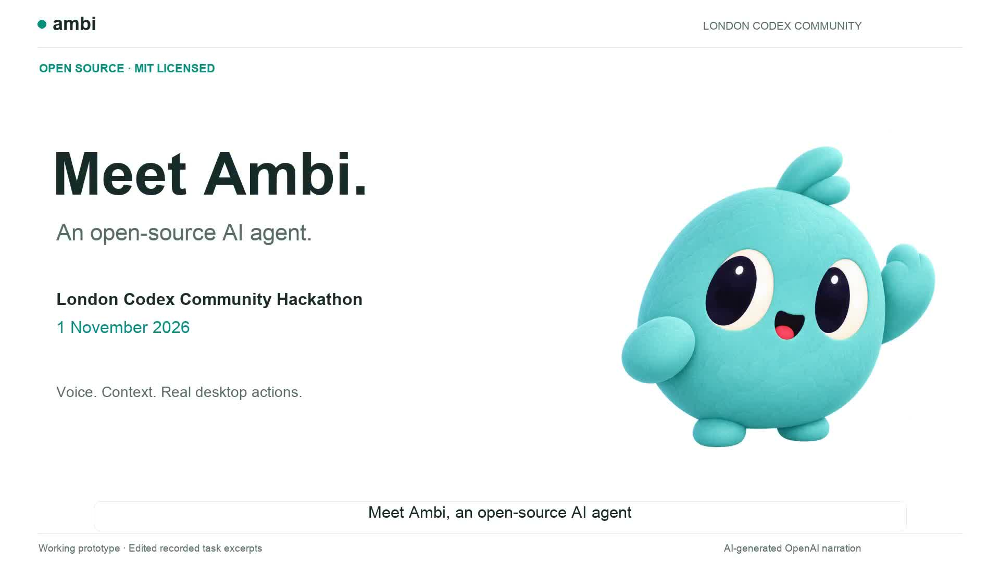](docs/media/hackathon-30s-2026-11-03/ambi-hackathon-30s.mp4)

[Watch the 30-second introduction](docs/media/hackathon-30s-2026-11-03/ambi-hackathon-30s.mp4) · [Captions, provenance and reproducible edit](docs/media/hackathon-30s-2026-11-03/README.md) · [MIT license](LICENSE)

Ask for help, follow Ambi’s actions and keep Stop within reach. Explore the source and help shape what comes next. The video uses OpenAI-generated narration and edited recorded tests; the extended walkthrough below includes the task details and recovery disclosure.

## Recorded Mac and Windows demo

[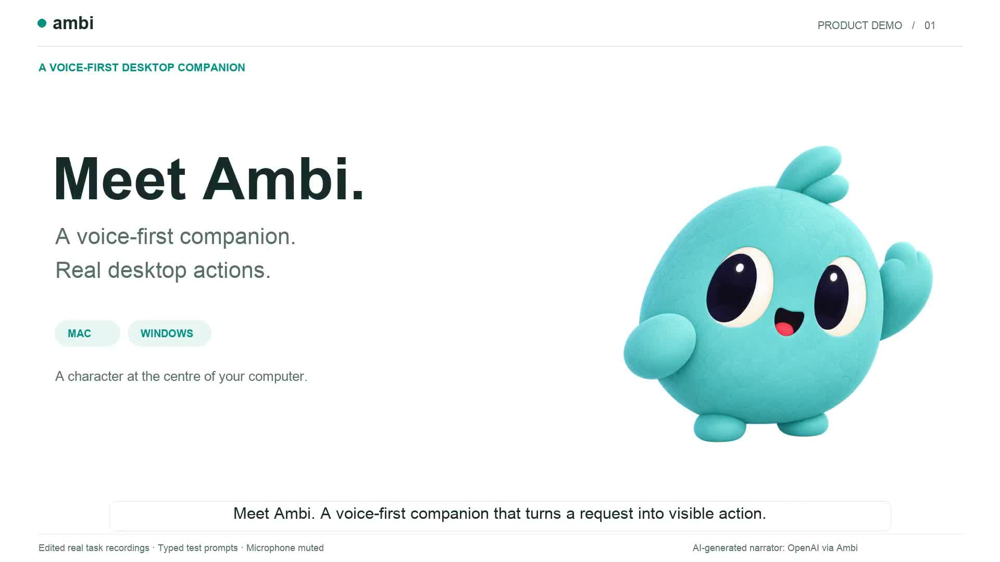](docs/media/product-demo-2026-11-03/ambi-product-demo.mp4)

[Watch the 95-second narrated demo](docs/media/product-demo-2026-11-03/ambi-product-demo.mp4) · [Captions and provenance](docs/media/product-demo-2026-11-03/README.md)

Edited real task recordings show Calculator on Mac, a checked Notepad save on Windows, and visible frame/Stop controls. The Windows recovery disclosure is retained. Narration is OpenAI-generated; browser handoff material is a labelled interface preview. These are narrow prototype demonstrations, not general reliability or release claims.

The current companion source is now available for [native Mac](desktop/macos/README.md), [native Windows](desktop/windows/README.md), and an [unverified Linux X11 preview](desktop/linux/README.md). See [current verification and remaining gates](docs/verification-2026-11-03.md).

## Desktop companion preview

The next desktop UI puts Ambi and voice first: a larger animated companion, visible microphone state, expanding actions, stronger activity tint, and a persistent **Stop task** control. Typing remains available through **Type instead**.

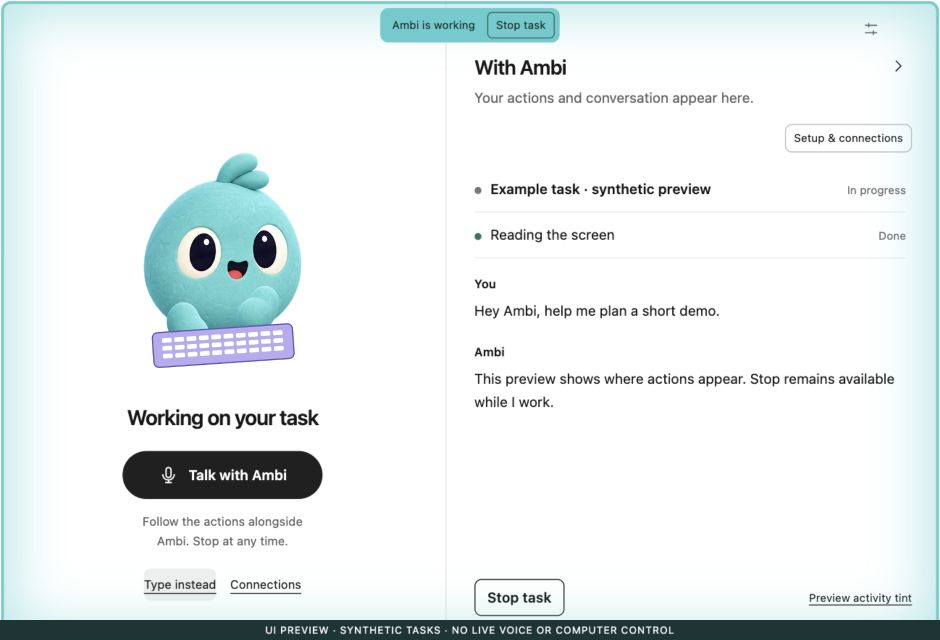

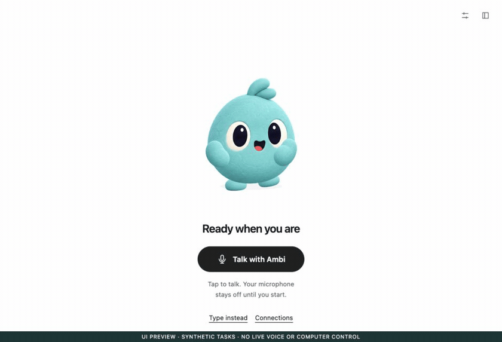

[Watch or download the MP4 walkthrough](docs/media/companion-2026-11-02/ambi-companion-walkthrough.mp4) · [Capture details and verification limits](docs/media/companion-2026-11-02/README.md)

**Development preview, not a live AI recording or a released desktop build.** The screenshots use fictional tasks and synthetic listening state; playback is retimed. They do not demonstrate wake-word detection or real computer control. The existing demo and setup instructions below remain unchanged.

The local candidate also adds a browser handoff for **ChatGPT, Claude and Gemini**: select a service, optionally copy a prompt, and review/send it in that service yourself. Conversation import, reply reading and automatic submission are not implemented.

<details>
<summary>See the browser-chat handoff</summary>

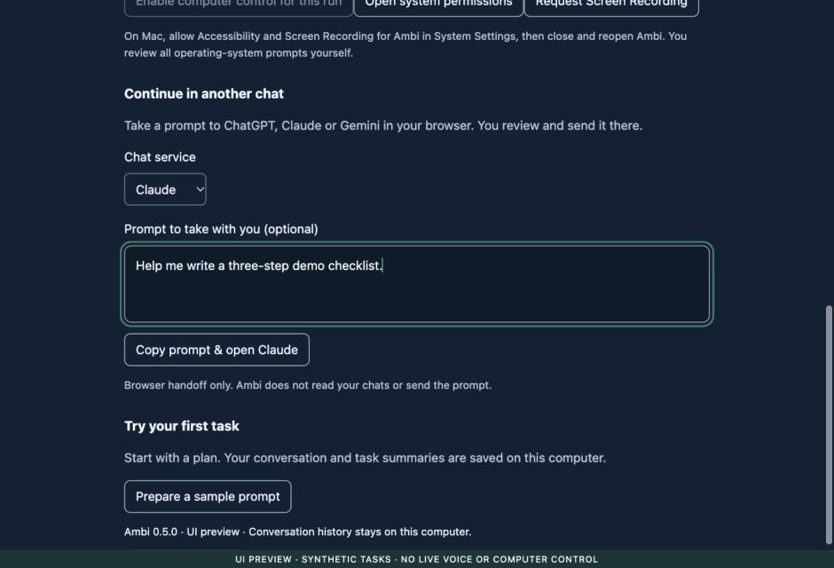

</details>

## Meet Ambi

You come back to your Mac with a half-finished task and a head full of context. Ambi remembers the notes you chose to save, greets you with that context, and can offer help when there is a useful opening. Ask for a concrete computer task, and a separate worker can take it on while you keep talking.

**Open Ambi → pick up the thread → receive an offer → choose whether to act.**

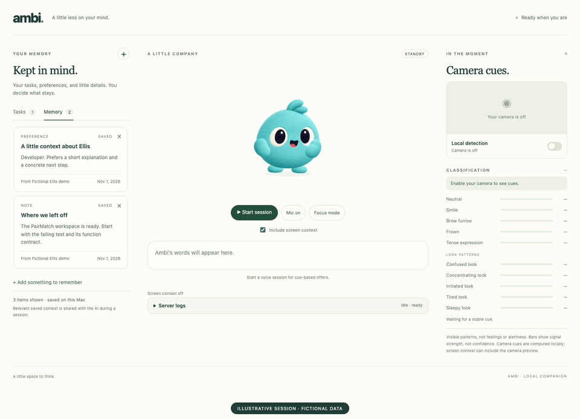

*An illustrative UI sequence, rendered in the real interface with staged session states. It shows the interaction design, not a recorded live AI run. [Media provenance and reproduction](docs/media/README.md).*

| Moment | What Ambi brings |
| --- | --- |
| **Pick up where you left off** | A spoken opening grounded in saved tasks, notes, and preferences. |
| **Stay in your flow** | Local camera cues and enabled screen context can inform a relevant offer. Focus mode keeps unsolicited offers quiet. |
| **Choose the next step** | Accept a suggestion, dismiss it, or ask directly. A facial cue never grants permission to act. |
| **Get a hand on your Mac** | A separate computer worker can click and type while conversation continues. Stop controls cancel future worker actions. |
| **Keep what matters** | Save useful notes and worker reports in local SQLite memory, with their source. |

## A thought, before a task

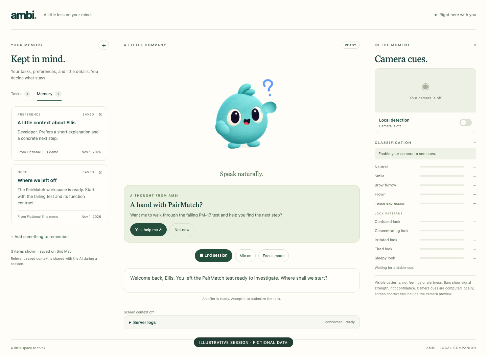

The offer stays a choice. Opening and proactive voice turns have tools disabled. Accepting the current offer or making an explicit request authorizes the specific task. Ambi can also correctly stay quiet.

Camera cues describe visible facial movements. They do not establish feelings, concentration, or alertness. In normal mode, the composite “look” labels can shape voice delivery but do not initiate offers.

## Keep talking while Ambi works

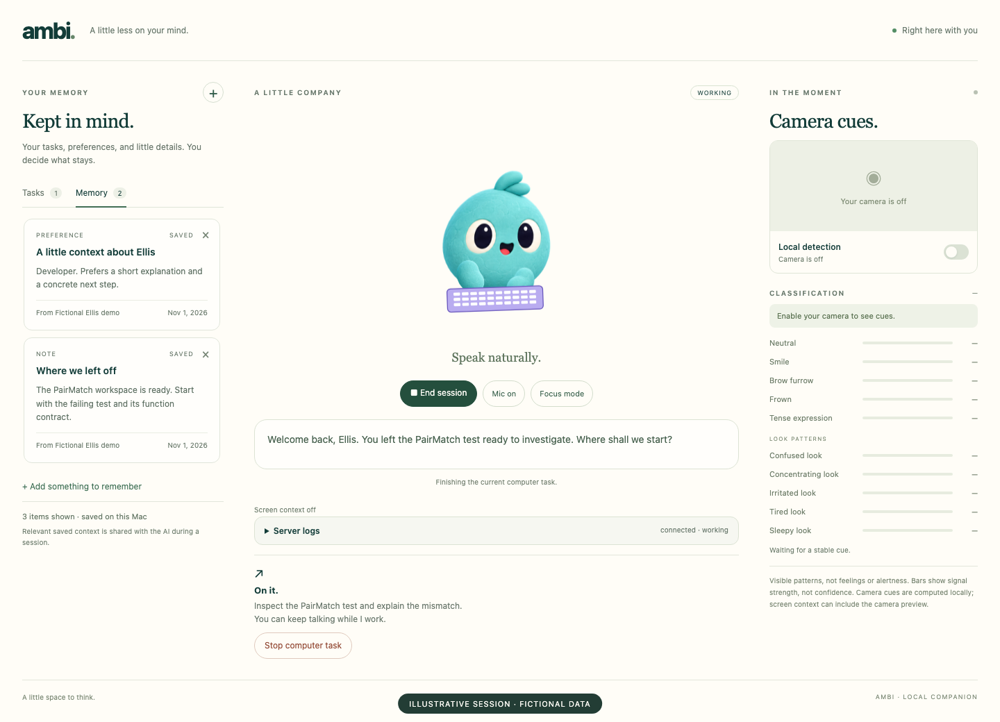

The voice agent can hand a task to a separate computer worker. Its activity card shows the task and eventual report. Saying “stop” or choosing **Stop computer task** cancels future actions; it does not undo earlier clicks or edits.

## Try it on your Mac

Use **macOS**, **Python 3.12 via [uv](https://docs.astral.sh/uv/getting-started/installation/)**, **Node.js 22+**, and **Chrome**.

```sh
git clone https://github.com/jenniferumoke/ambi-openai-hackathon.git
cd ambi-openai-hackathon
cp .env.example .env
# Add OPENAI_API_KEY to your private .env file.
./scripts/start.sh --no-autostart
```

The script installs locked dependencies, builds the interface, and opens **http://127.0.0.1:8765** with fictional developer **Ellis** and a disposable PairMatch workspace. Click **Start session** when ready. Turn on **Camera cues** separately. For the timed rehearsal, follow the [one-minute Ellis guide](eval/test/README.md).

- **Default demo:** `./scripts/start.sh` starts Ellis voice automatically. Its cue-to-offer catalog is deterministic; it replaces normal Decisions selection.
- **Your own saved context:** `./scripts/start.sh --no-demo` uses ordinary local memory and the normal Decisions policy.
- **Permissions:** the app launching Python usually needs macOS Accessibility and Screen Recording for desktop work; allow microphone access and Chrome camera access when using those features. See [setup and troubleshooting](docs/LOCAL-DEVELOPMENT.md#mac-permissions).

Local memory and camera cues can be explored without an API key. Voice, Decisions, and screen analysis need API access. The first UI build downloads the face model. **End session** stops voice; closing the browser alone does not. **Control+C** stops the server.

## How the pieces fit

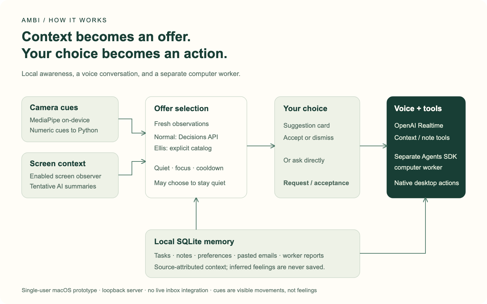

[Open the editable architecture diagram and mode notes](docs/architecture/README.md).

| Layer | Implementation |
| --- | --- |
| **Companion interface** | Vite / JavaScript, animated Rive character, controls for memory, camera, focus, and task cancellation. This is the repository's test and demo frontend. |
| **Local awareness** | MediaPipe Face Landmarker in a browser worker; numeric cues go to Python. Enabled screen observation produces tentative context. |
| **Offer selection** | Normal mode uses the Decisions API (`gpt-6-luna`) with freshness, quiet, focus, and cooldown gates. Ellis demo mode uses its explicit catalog. |
| **Conversation** | OpenAI Realtime (`gpt-realtime-2.1`), with context tools and cue-informed delivery. |
| **Computer worker** | OpenAI Agents SDK / `gpt-6.1-terra`, separate from the voice conversation. |
| **Memory** | Source-attributed local SQLite tasks, notes, preferences, pasted email excerpts, and worker reports. |

## Rehearse with a whole fictional context

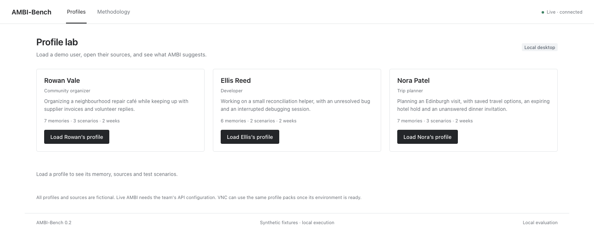

**AMBI-Bench** prepares fictional profiles, source files, and isolated memory so a reviewer can observe whether an offer was useful. Rowan has community paperwork, Ellis has a paused debugging task, and Nora has travel planning to finish. It records human reviews rather than an automatic benchmark score.

```sh
uv run python -m bench --serve
```

Open **http://127.0.0.1:8766**. Loading the lab does not enable sensors. Live sessions need API configuration and explicit session controls. [Profile-lab guide](bench/README.md).

## Context, with clear boundaries

Ambi is a **single-user, local desktop hackathon prototype**. The server binds to loopback. Tasks, notes, and email excerpts are entered locally; there is no live inbox or reminders integration.

Camera cues are computed on-device. Audio, relevant saved memory, and enabled screen screenshots go to OpenAI; those screenshots can include the visible camera preview. The API key stays in Python. The separate cue journal retains numeric cue changes for up to 24 hours or 500 events, without camera images. Inferred feelings are never saved as personal memory.

Timing depends on hardware, lighting, permissions, and network/API access. The synthetic three-frame filter result is **134 ms**, not a measured face-to-speech guarantee. The screenshots and animation above do not establish live voice, camera, or desktop-task success. [Detailed behavior and limits](docs/LOCAL-DEVELOPMENT.md#timing-and-limits).

## Built with OpenAI

Ambi combines **OpenAI Realtime**, **Decisions**, and the **Agents SDK** with local memory and on-device camera processing. **OpenAI Codex** helped prepare this README, inspect the current implementation, capture the demo interface, and verify the documentation assets.

The voice and computer worker began with an earlier [voice-computer-agent prototype](docs/prototype.md), then gained local memory, an ambient decision loop, and a companion interface for the hackathon. Camera processing uses Google's [MediaPipe Face Landmarker](https://developers.google.com/edge/mediapipe/solutions/vision/face_landmarker/web_js). Third-party code and assets retain their own licences.

## Explore and develop

- [Developer guide](docs/LOCAL-DEVELOPMENT.md) — full setup, permissions, normal-mode walkthrough, privacy, and checks.
- [Ellis demo](eval/test/README.md) — cue/action mapping and one-minute rehearsal.
- [AMBI-Bench](bench/README.md) — fictional profiles and human review workflow.
- [Camera cue API](docs/camera-cues-api.md) — frontend/backend contract.
- [Integration guide](AGENTS.md) — state, transport, and source-of-truth files.
- [Screenshots and animation](docs/media/README.md) — provenance and capture instructions.

```sh
uv run pytest -q
(cd ui && npm test && npm run build)
```

## License

Ambi’s original project code is available under the [MIT License](LICENSE). Third-party code, models and assets retain their own licenses.
