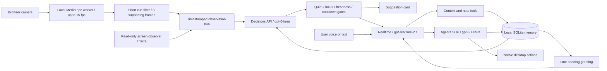

# Ambi

**Ambi is an ambient computer-use companion for macOS.** It remembers the tasks
and notes you choose to save, notices brief facial cues and activity on your
screen, and offers timely help through voice or a suggestion card. When you ask
it to take on a computer task, a separate worker can use your desktop while the
conversation continues.

The core demo journey is: **open Ambi → hear a greeting grounded in saved context
→ work normally → receive a relevant offer → accept it or ask for help → see a
computer task completed and remembered.** Facial cues inform whether Ambi might
offer help; they do not establish how someone feels or authorize an action.

This hackathon prototype has a Python backend and a Vite/JavaScript interface.
Tasks, notes, and email excerpts are entered locally; there is no live email or
reminders integration. It is built for one user on one Mac.

## Start the demo

For fictional Ellis sample data, run `./scripts/start.sh --demo ellis`.
It prepares isolated memory and a disposable PairMatch workspace and starts
voice automatically. Add `--no-autostart` to start manually. Responses and offers
come from the normal agent policy, with no fixed greeting or cue/action catalog.
See [the Ellis demo guide](eval/test/README.md).

From the repository root, create a local API-key file, then start the app:

```sh
cp .env.example .env
# Add your OPENAI_API_KEY to .env.
uv sync --locked --python 3.12
(cd ui && npm ci && npm run build)
uv run python server.py --open
```

The last command starts Python and opens <http://127.0.0.1:8765>.
Click **Start session**: Ambi speaks first using saved context, without a voice
prompt. Camera detection has its own switch. Use Chrome for the demo. Keep
Terminal running; **Control+C** shuts down the server.

For a fresh checkout, install [uv](https://docs.astral.sh/uv/getting-started/installation/)
and Node.js 22 or newer. The commands install the pinned Python 3.12 dependencies
and UI packages. The first build downloads the face model; later runs use local
assets. Voice, Decisions, and screen analysis require internet/API access. Keep
`.env` private; it is ignored by Git.

### Mac permissions

The browser displays Ambi, but Python runs voice and desktop actions. macOS gives
desktop permissions to the app launching Python—normally Terminal.

1. **System Settings → Privacy & Security → Accessibility → Terminal** allows
   the computer worker to click and type.
2. **Screen & System Audio Recording → Terminal** allows screen understanding.
   Some macOS versions call this **Screen Recording**.
3. Allow microphone access when asked. Choose the Mac microphone and speakers
   in **System Settings → Sound**; the audio engine uses system defaults.
4. Quit/reopen Terminal if macOS requests it, then launch again. Allow camera
   access in Chrome when switching on **Camera cues**.

If macOS cannot start voice processing for the selected audio route, Ambi uses
the compatible audio backend. Voice and typed turns still work; the microphone
is muted during playback, so spoken interruptions of replies are unavailable.
Choosing the built-in microphone and speakers in **System Settings → Sound**
may restore voice processing.

If launching inside Codex, those permissions belong to Codex instead. Memory and
local camera can be tried without desktop access. The UI reports missing desktop
permissions and disables computer control. Run `uv run python main.py --check`
for a device/permission report.

## Two-minute walkthrough

1. Add a task or note with **+**. The initial task is the real hackathon brief.
   Email excerpts can be pasted; no inbox is connected.
2. **Start session** and let the opening greeting play. Say “Help me make a short
   demo checklist and save it as a note.” The note appears under **Memory**.
3. Turn on the camera in good light. A brief smile or brow furrow should move the
   cue meters. An event remains available after your face relaxes, so you need
   not hold an expression through an API call. Relevant context and a quiet
   conversation can lead to an offer. Offers have a 45-second cooldown.
4. Ask for a small concrete desktop task, such as creating a checklist in an open
   text editor. The worker card shows activity. Say “stop” or use **Stop computer
   task** to cancel. Let the worker use the mouse while it is running.
5. **End session**, refresh, and show that memory persists. Start again for a fresh
   greeting. **Focus mode** suppresses unsolicited offers while allowing requests.

Cue scores are facial geometry, not emotion probabilities. The five look labels
describe visible combinations such as a raised brow with narrowed eyes, a
yawn-like movement, or prolonged eye closure; they cannot establish confusion,
concentration, irritation, tiredness, or sleepiness. They are display-only and
do not initiate proactive offers. The classifier can correctly choose to stay
quiet; a smile alone does not prove work is finished.

## Architecture



The camera worker sends numeric cues to Python, without camera-image requests to
Decisions. A classic Web Worker runs the real model off the UI thread. It requires
one visible face, rejects stale/out-of-order data, and retains brief cues for four
seconds. The old two-second image classifier is retained only in the legacy CLI.

Decisions selects `none`, `offer_task_help`, or `acknowledge_progress`; it does not
execute actions. The runtime rechecks freshness and conversation/computer activity
after the API responds. Startup and proactive turns have tools disabled. A later
user request or accepted suggestion can use the normal tools. Async Realtime tool
calls let computer work run while the conversation continues.

Memory is ignored `data/ambi.sqlite3`: tasks, notes, pasted emails, explicitly
requested preferences, and source-labelled worker reports. Inferred feelings are
never saved as personal memory. A separate local cue journal stores visible cue
changes for up to 24 hours or 500 events, without images; see
[camera cue API](docs/camera-cues-api.md) for the teammate frontend contract.
Bounded retrieval prioritizes open tasks and preferences. Saved text and sensor
observations are context, never authorization. Delete controls remove memory
records; start a new voice session to discard old conversational context too.

The API key stays in Python; the browser uses a local session token. Audio,
relevant memory, and enabled screen screenshots go to OpenAI. Camera cues are
computed locally, but screen screenshots can include the visible camera preview.
This is a single-user, loopback-only prototype, not an internet-facing server.

## Timing and limits

- The synthetic filter test detects three frames spaced 67ms apart in **134ms**.
  This is not a measured face-to-speech guarantee. Real lighting, head angle,
  hardware, inference time, and network latency affect results.
- Vision inference is shown as **ms/frame**. Decisions has a 2.5-second deadline;
  slow or stale results are discarded. Screen context samples every five seconds.
- macOS echo cancellation and transcription-confirmed turns reduce playback echo
  and keyboard triggers. They are **not speaker identification or source
  separation**. Rehearse with the actual room and audio setup.
- The transport adapter uses internals of the pinned Agents SDK to coordinate
  proactive and user turns. Keep the lockfile and rerun tests before upgrading.
- Closing the browser does not end Python voice. Use **End session** or stop
  Terminal. Moving the mouse to a primary-screen corner triggers the inherited
  computer failsafe.

## Development

```sh
uv sync --locked --python 3.12
uv run pytest -q
cd ui
npm ci
npm test
npm run build
cd ..
uv run python server.py
```

Rebuild after UI edits; restart the server after Python edits. The production
build is the verified demo path for the MediaPipe classic worker. The original
CLI is `uv run python main.py`; see [docs/prototype.md](docs/prototype.md).
Generated assets, credentials, local memory, and screenshots are ignored by Git.

## AMBI-Bench

Run the separate local evaluation dashboard:

```sh
uv run python -m bench --serve
```

Open <http://127.0.0.1:8766> to load fictional user profiles with two weeks of
activity, isolated demo memory, and realistic invoices, emails or coding sessions.
Launch AMBI with a profile and watch its proactive suggestion in the actual app. Starting sensors remains explicit in AMBI. Live sessions need the team's
API configuration. See [profile-lab setup](bench/README.md) for the workflow,
local/VNC boundaries and demo instructions.

## Credits and provenance

The voice and desktop worker started from an earlier
[voice-computer-agent prototype](docs/prototype.md), then gained local memory,
the ambient decision loop, and this interface for the hackathon. The browser
camera path uses Google's [MediaPipe Face Landmarker](https://developers.google.com/edge/mediapipe/solutions/vision/face_landmarker/web_js)
model and the `@mediapipe/tasks-vision` package. Voice, Decisions, and computer
use run through the OpenAI APIs and Agents SDK linked below. No personal inbox
data or API credentials are included in the repository.

References checked on 1 November 2026:
[Decisions](https://developers.openai.com/api/docs/guides/decisions),
[Realtime Agents SDK](https://openai.github.io/openai-agents-python/realtime/guide/),
[MediaPipe](https://developers.google.com/edge/mediapipe/solutions/vision/face_landmarker/web_js).
