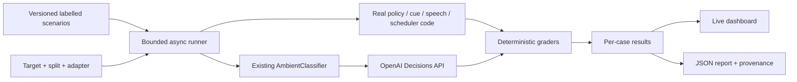

# AMBI-Bench v0.1

Decision: measure whether AMBI offers relevant help at the right moment, while preserving silence, freshness and user control. Build against the team's implementation, not a replacement agent.

Branch: `ambi-bench`. Initial integration base: `f5f38bb` on `origin/main`, 1 November 2026. The three-person team's application remains owned by its existing developers. Benchmark files live in `bench/`, with tests in `tests/test_bench.py`; product behavior is not changed to improve a score.

## Actual interfaces

There are two current intervention paths. Keep their results separate:

| Target | Interface | What we can establish |
| --- | --- | --- |
| Voice notification policy | `NotificationPolicy.evaluate(snapshot, TurnContext, now)` | Evidence, freshness, speech deferral, cooldown, deduplication |
| UI intervention classifier | `AmbientClassifier.decide(snapshot, memory)` | Live Decisions choice quality over `none`, `offer_task_help`, `acknowledge_progress` |
| UI scheduler | `AmbientLoop.run()` with an isolated runtime and scripted classifier | Focus/speech gates, stale-result rejection, cooldown; not live model quality |
| Brief-cue state | `FastCamera.ingest(CuePacket, now)` and `ObservationHub.snapshot(now)` | Retention, expiry, missing-face and out-of-order handling; not camera recognition accuracy |
| Speech input gate | `SpeechGate.rejection(transcription)` | Silence/noise rejection and valid short commands; not speaker identity or audio recognition accuracy |

No benchmark adapter opens a camera, microphone, desktop controller or real voice session. Fixtures contain synthetic observations and fictional task context. Live mode sends these fixtures only to the existing classifier, using the team's configured model and authentication.

## Flow

## Scenario contract

Every case has a stable ID, suite, category, split, input, expected output, rationale and severity. Labels encode a product requirement; they are not generated from the output under test. Exact reasons are asserted only where the reason itself matters. A scenario can contain multiple ordered policy steps so cooldown and duplicate handling are evaluated within one episode.

Seed a small synthetic set covering supported help, normal work, absent/ambiguous cues, explicit blockers, verified progress, speech/activity gates, stale observations, context switches, duplicate offers, cue expiry and noise. Keep a development/holdout split and report it. This is a hackathon regression benchmark, not an independently validated population benchmark. Have another teammate review the labels before using it for claims about real users. Do not infer emotional truth from facial geometry.

## Grading and reporting

- Exact decision accuracy and confusion matrix for intervention suites.
- False-interruption rate: predicted interventions on cases labelled to stay quiet or defer, divided by all labelled quiet/defer opportunities. Show numerator and denominator.
- Missed-help rate: no intervention on cases labelled for help/progress, divided by positive opportunities.
- Precision and recall for intervening, with undefined denominators shown as unavailable.
- Pass/fail/error counts and critical failures by suite. Errors are not correct silent decisions.
- p50/p95 wall time separately by suite and execution mode. Offline policy timings do not imply model, camera-to-speech or end-to-end latency.
- Baselines: always quiet and always intervene, evaluated only on compatible intervention cases. An always-quiet model must not look good by hiding missed help.
- Store commit SHA, relevant source hashes, dataset hash, configuration, timestamps and whether the worktree was dirty. Never include environment values, credentials, raw provider error bodies or personal session data.

Zero false interruptions in a small synthetic suite is a regression result, not a safety guarantee. Release gates should show critical failures independently of an overall pass percentage. No model-generated judge is needed for these bounded decisions. If adding a judge for spoken helpfulness later, calibrate it with human-labelled examples and report disagreement.

## Live dashboard

A separate loopback Starlette service on port 8766 serves a standalone HTML/CSS/JavaScript dashboard and authenticated WebSocket updates. It uses the project's existing stack and dependencies, avoiding edits to the product UI or audio runtime.

Primary journey: choose offline/live mode and split → run suite → watch cases complete → select a failure and inspect expected/actual/rationale → download the JSON evidence. Show connection and run status, cancellation, per-suite results, interruption errors, latency, case filters and reproducibility metadata. Runs are real; no fabricated results or animated preset scores. Live API mode is explicit, bounded, sequential and disabled without credentials.

The initial dashboard observes benchmark execution. Attaching personal live AMBI sessions is a future opt-in trace adapter and requires a redacted event contract. It is not implied by this dashboard.

## Team integration

Fetch team changes every ten minutes until 17:00 London time today. Merge `origin/main` only when `ambi-bench` is clean and no run is active. Preserve local edits; never auto-stash, rebase shared history or force-push. Inspect unmerged feature branches for interface changes, but do not merge them without coordination. Pin each run to its loaded source fingerprint and refuse a new run if imported product modules changed until the benchmark server restarts.

## Workspace artifact verification

The second journey is implemented in `WorkspaceLab`: prepare a fresh synthetic source folder → open it in VS Code → give the displayed task to the actual AMBI app → verify the saved artifact. Three scenarios cover unpaid bills, meeting notes with a superseded draft, and a broken coding exercise. Source hashes detect unintended edits. Reference answers and deliberate near misses test the graders separately from AMBI.

This is operator-driven. A local artifact pass does not establish authorship, successful voice/camera integration or absence of external actions. Document checks are lexical and format-constrained; the code fixture runs eight vectors in a bounded subprocess and accepts a restricted Python subset. Neither is a general-purpose semantic judge or sandbox. See `bench/README.md` for the full runnable journey.

The dashboard uses plain system typography, compact tabs/tables, stacked suite results, an expected/observed matrix, selectable case cells and a policy baseline comparison. Comparison requires matching dataset, source fingerprint and split; it never compares baseline-only aggregate scores against the entire product suite.

## Scope after the first working benchmark

Add acceptance/dismissal traces, memory-source grounding and camera-to-speech spans once the team exposes those trace contracts. Do not claim the first benchmark covers real camera accuracy, speaker separation, actual tool execution or end-to-end voice timing.

## Sources and credit

All initial cases are newly authored synthetic scenarios. AMBI's imported prototype and pre-existing tests belong to the team and retain their history. The benchmark uses existing production logic rather than copying it.

- [OpenAI evaluation best practices](https://developers.openai.com/api/docs/guides/evaluation-best-practices)
- [Decisions guide](https://developers.openai.com/api/docs/guides/decisions)
- [Decisions routing Cookbook](https://developers.openai.com/cookbook/examples/decisions/customer_request_routing)
- [Realtime evaluation Cookbook](https://developers.openai.com/cookbook/examples/realtime_eval_guide)
