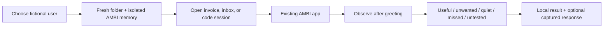

# AMBI-Bench: simple profile lab

The primary evaluation is a fictional person's desktop session, reviewed by a human. It asks: given this user's memory and current activity, did AMBI offer a useful next step or correctly stay quiet?

## Profile contract

`bench/profiles/*.json` defines identity, role, a fixed snapshot date, preferences/tasks/completed results, a two-week activity timeline, source-pack folders, historical file timestamps and simple scenarios. Each scenario names a source, setup instructions, an offer/quiet expectation, a suggested behavior in plain English and a boundary. Reviewer expectations are not seeded as assistant answers.

Initial profiles: Rowan (event paperwork), Ellis (debugging), Nora (trip planning). Each includes a scenario where restraint is the correct behavior. All data is fictional.

## Load and run

`ProfileLab.prepare()` copies sources into `data/bench/profiles/<id>/desktop`, creates a separate SQLite database using the team's `MemoryStore`, and writes an identifiable demo-session marker. It does not read or replace the user's normal AMBI memory. `bench.profile_app` uses the existing `server.create_app(db_path=..., seed=False)` interface. No production agent, prompt, sensor or auth code is changed.

The dashboard can launch one owned demo process on loopback port 8765. It refuses to displace another server. Starting voice/camera/screen collection remains an explicit operation in AMBI's UI. The test machine must have the same app dependencies, credentials and OS permissions as an ordinary AMBI session.

## Observe and review

Begin observation only when the app is connected and its greeting has finished. Record the current transcript/event IDs, then capture new assistant output and suggestions. Verify the process and memory marker before reading session data. A user turn is counted but its text is not stored in the profile report; it warns the reviewer against counting prompted responses as proactive.

The review is intentionally simple and manual. Saved results carry the expected behavior, operator verdict/notes, optional captured evidence, profile/source fingerprints and commit. No synthetic or scripted response is presented as a live result. AMBI's event/transcript buffers are bounded, so one late capture is not a full-session recording.

## Source surfaces

- Actual PDFs for invoices, receipts and planning records, with readable source files for regeneration.
- Local email exports shown as email messages in a fictional offline inbox-style reader.
- A VS Code/Cursor workspace with a small bug, issue description, visible tests and a captured failing log.
- Itinerary and saved travel options with explicit unbooked/completed states.

Only manifest-listed source files are served in the preview routes. Databases, session JSON and arbitrary local paths are not source previews. Source copies and results remain ignored by Git. The repository holds only fictional originals, manifests and code.

## VNC boundary

The same repository and profiles can be loaded on the test machine; the operator then uses its desktop through VNC. No VNC transport has been supplied yet. AMBI's platform support and permissions must be checked on that host. Local validation currently uses macOS. This lab does not add background file watching, real inbox integration or mood inference to AMBI.

## Secondary developer tooling

The original deterministic component checks, baselines and artifact graders remain available under secondary tabs. They are useful debugging tools, not prerequisites for the profile journey. Their design is preserved in [component architecture](ambi-bench-component-architecture.md) and [component checks](../bench/COMPONENT_CHECKS.md).
