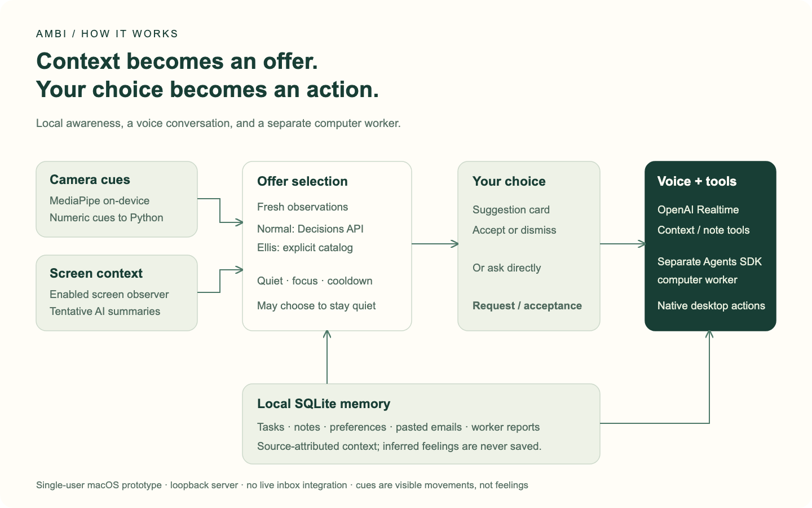

# Ambi architecture

[Editable SVG](ambi-architecture.svg) · [PNG](ambi-architecture.png)

Created for this README on 1 November 2026 from `server.py`, `app_runtime.py`,
`ambient.py`, `voice_realtime.py`, `voice_style.py`, `screen_observer.py`,
`memory_store.py`, and the Ellis demo guide at main commit `70a7d1b`.
This is an implementation overview, not a deployment or measured-latency diagram.

Normal mode uses Decisions selection; the default Ellis demo uses a deterministic
cue/action catalog. Both preserve confirmation before computer work. Opening and
proactive turns disable tools. Realtime can use context/note tools and hand off
an explicitly requested computer task to the separate worker.

Local memory informs offer selection and conversation; note tools and worker
reports can write memory. The bidirectional memory/tool relationship is simplified
in the figure. Camera frames stay on-device for cue processing, but enabled screen
screenshots sent to OpenAI can include the camera preview. Screen analysis and
voice require network/API access. See [the full guide](../LOCAL-DEVELOPMENT.md).
