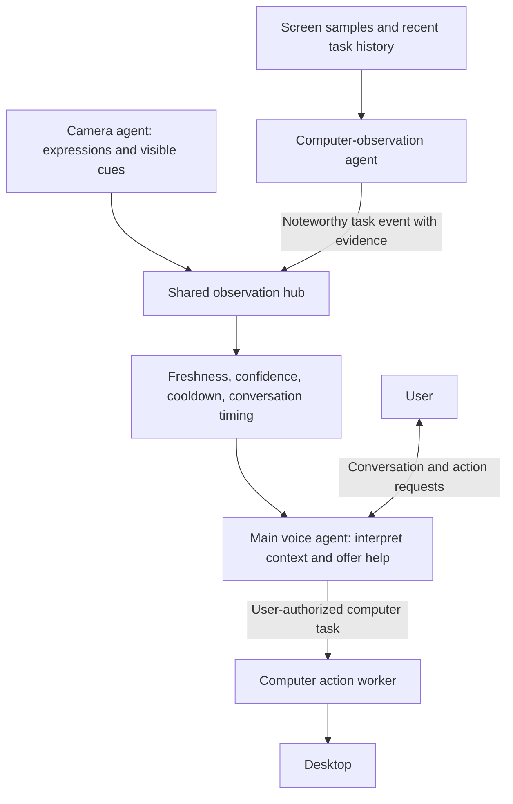

# Voice computer agent

A minimal Python terminal app: speak to **`gpt-realtime-2.1`**, which delegates desktop tasks to **`gpt-6.1-terra`** through the **OpenAI Agents SDK**.

```text
Microphone ↔ macOS voice processing ↔ RealtimeAgent ↔ Speakers
                        │ use_computer(task) / stop_computer()
                        ▼
              Agent(model="gpt-6.1-terra")
                        │ SDK ComputerTool → Responses API {"type": "computer"}
                        ▼
              Local desktop adapter (PyAutoGUI)
                 screenshots / mouse / keyboard
```

The SDK runs OpenAI's computer-use loop, including batched actions and returning screenshots. `desktop.py` implements the local OS operations required by `ComputerTool`. The Python app uses one macOS `AVAudioEngine` for microphone input and speaker playback, with Apple's voice processing enabled for acoustic echo cancellation. There is no model-generated Python execution, browser extension, frontend, or separate server.

The source is organized around that flow:

- `main.py` configures both agents, connects voice tools to the computer worker, and manages the session lifecycle.
- `desktop.py` translates the SDK's computer actions into local screen, mouse, and keyboard operations.
- `mac_audio.py` handles hands-free microphone capture, echo cancellation, and speaker playback on macOS.
- `audio_io.py` provides the PortAudio backend for push-to-talk; both audio backends expose the interface used by `main.py`.
- `camera.py` owns optional macOS still capture in a helper process; `expression_monitor.py` classifies sampled frames with Decisions and filters recent observations. `proactive_controller.py` rehearses check-in timing using read-only voice/task status.
- `screen_capture.py` captures the primary display in memory; `screen_observer.py` runs a vision agent with no action tools. `observation_hub.py` maintains shared fresh context, and `observation_sidecars.py` supervises the selected observers and joint terminal log.
- `proactive_voice.py` gates noteworthy task events for the main voice agent; `proactive_realtime.py` coordinates those optional turns with the pinned SDK's Realtime response sequencer.

## Run on your Mac

`uv` is already installed on this computer. It selects Python 3.12 and installs the locked dependencies; the system's Python 3.8 is too old for this app.

```bash
cd /Users/jenniferumoke/source/openai-hackathon-proto
cp -n .env.example .env
```

Edit `.env` and set `OPENAI_API_KEY` to your own API key. Your OpenAI API project needs billing and access to both models. Keep the key in `.env`, which is gitignored.

In **System Settings → Privacy & Security**, enable these permissions for the terminal application you will run the app from (Terminal, iTerm, or Codex if using its terminal):

- **Accessibility**: mouse and keyboard control.
- **Screen Recording** (called **Screen & System Audio Recording** on some macOS versions): screenshots.
- **Microphone**: allow the prompt when the app first opens audio input.

Quit and reopen that terminal after granting permissions. If macOS lists Python as the requesting application, grant access to that executable as well. `--check` reports the permissions visible to the running process.

```bash
uv run python main.py --check
uv run python main.py
```

Start speaking after **Connected** appears. macOS voice processing reduces speaker audio in the microphone feed while keeping your microphone live. Hands-free turns now use `gpt-transcribe` to confirm speech before requesting a reply. VAD alone neither generates a reply nor interrupts playback. Empty transcripts, non-speech annotations and low-confidence transcripts are discarded, including their audio conversation item. Valid short commands such as “stop”, “yes”, and “bye” remain accepted. Confirmed speech interrupts playback and requests the next response; this adds transcription latency to interruption. Push-to-talk retains its explicit Enter-to-submit flow.

If your audio device does not support macOS voice processing, use push-to-talk as a fallback:

```bash
uv run python main.py --push-to-talk
```

In push-to-talk mode, press Enter, speak, and press Enter again to submit your turn. It needs an interactive terminal.

Try:

> “Open TextEdit, create a new document, and type: Hello from my voice computer agent.”

> “What can you see on my screen?”

> “Stop.”

> “Bye.”

The worker can use apps on the **primary display**. Keep target windows there. It uses your real desktop, so let it finish before moving the mouse or typing. Moving the mouse to a primary-display corner triggers PyAutoGUI's emergency stop on its next operation. Say **“bye”**, **“stop the agent”**, or **“stop everything”** to end the session, or press **Ctrl+C**. A bare **“stop”** cancels active computer work; when no computer task is running, it ends the whole session. Session shutdown waits for both observers and their in-flight model work to stop before reporting **Stopped**. Stopping does not undo completed actions.

## Test one part at a time

Test computer use without audio:

```bash
uv run python main.py --text "Describe what is visible on my screen. Do not click or type."
```

The default echo-cancelled mode uses the input and output devices selected in **System Settings → Sound**. Choose devices there before starting the app. For the push-to-talk fallback, you can instead select PortAudio devices explicitly:

```bash
uv run python main.py --list-devices
uv run python main.py --push-to-talk --input-device 1 --output-device 2
```

IDs are machine-specific; use your device list. Device names also work, e.g. `--input-device "MacBook Air Microphone"`. Check a selection with `--check --input-device 1 --output-device 2`.

Run the offline tests:

```bash
uv run pytest -q
```

The tests use the real SDK with mocked HTTP and Realtime transports and a fake desktop. They verify model/tool serialization, computer action dispatch, screenshot scaling, audio buffering, cancellation, timeouts, and safety-check rejection. They make no API calls and do not control your desktop.

## Camera observation-only mode

Camera observation is **off by default**. Enable the silent monitor alongside the existing voice assistant:

```bash
uv run python main.py --observe
```

The existing voice tools and computer delegation remain available; hands-free interruption waits for speech confirmation as described above. The camera monitor logs visible expression cues, a **tentative** emotion interpretation, and when it **would** offer a check-in. It never injects camera observations into the voice conversation, speaks, or starts computer work. It also works with `--push-to-talk --observe`.

Test just the camera and Decisions API without opening the microphone, voice session, or desktop adapter:

```bash
uv run python main.py --observe-only
```

Allow **Camera** access for the launching terminal when macOS prompts. If access was denied, enable it in **System Settings → Privacy & Security → Camera**, then restart. Camera device `0` is the first detected video device; use `--camera-device 1` to select another. Camera monitoring currently supports macOS only. Your API project also needs access to `gpt-6-luna` on the Decisions API.

While enabled, the monitor takes at most one photo every two seconds and sends its resized JPEG (maximum 640 pixels on its longest side) to OpenAI. Slow requests reduce the sampling rate; frames and API requests never accumulate in a queue. Camera metadata is stripped. The app saves no photos, video, or observation logs to disk; terminal output contains labels, estimated probabilities, timings, and aggregate request/token counts. OpenAI's API data controls apply to uploaded images; transient local handling is not a promise of zero server-side retention.

Example terminal events (illustrative):

```text
[observe ...] sample {"possible_emotion":"confused","interpretation":"tentative",...}
[observe ...] shadow {"stable_expression":"confused","action":"defer","reason":"user_speaking",...}
[observe ...] shadow {"action":"would_check_in","reason":"observation_only_no_speech","proposed_text":"Would a walkthrough help?",...}
```

Rejected classifications include a specific `reason`, readable `message`, sample `sequence`, and request `latency_ms`. When applicable, they identify the affected `question` and `field` and include finite numeric summaries or missing expected names. For example:

```text
[observe ...] classification_unavailable {"sequence":8,"error":"InvalidObservation","reason":"distribution_sum_mismatch","question":"apparent_emotion","field":"probabilities","probability_sum":0.97,"expected_sum":1.0,"tolerance":0.02,...}
```

`refused_answer` identifies a required question the model declined. `answer_names_mismatch` lists missing expected questions and counts unexpected answers. `unexpected_answer_type` shows the expected and received types. Probability diagnostics distinguish nonnumeric, nonfinite, and out-of-range values, including whether the affected field was confidence or a distribution entry. `incomplete_distribution` lists missing labels; `distribution_sum_mismatch` shows the sum and existing tolerance; `inconsistent_emotion_choice` compares the selected label's probability with the highest probability. Duplicate answers/labels and unknown emotion labels have separate reasons.

Diagnostics never print raw responses, images, or arbitrary API error text. Unrecognized question names are redacted; unexpected names and unknown label values are not echoed. A refusal of `usable_face` or malformed output clears the sample. Refused individual cues are marked unavailable and removed from cue history; independently answered cues can still accumulate evidence. A refused emotion label remains uncertain. `classification_partial` lists unavailable questions. Refusals and timeouts resume on the normal sampling cadence; HTTP 429 rate limits retain bounded backoff. These diagnostics do not change the detection threshold, persistence rule, or distribution tolerance.

Expression labels include happy, sad, angry, confused, excited, neutral, and uncertain. Observable cues include smiling, frowning, furrowed brows, widened eyes, and facial tension. These do not establish actual feelings or mental health. Poor visibility or multiple faces clear the state. The filter requires three supporting observations within the latest five samples; weak evidence stays uncertain. Stable state expires after ten seconds without fresh supporting evidence.

The shadow controller proposes check-ins for persistent apparent sadness, anger, or confusion. It defers during user speech, response generation, undrained speaker playback, computer work, or its cooldown. It proposes once per expression episode and enforces a 60-second gap between proposals. Standalone mode has no voice/task activity to defer around.

Say **bye**, **stop the agent**, or press **Ctrl+C** to stop the combined session and release the camera. In standalone mode, use **Ctrl+C**. Camera failures disable the monitor while voice continues. Transient Decisions failures clear expression state and retry at the normal sample cadence (rate limits back off); access/configuration failures disable monitoring. Restart with the observation flag to re-enable it. A bare **stop** cancels active computer work, or ends the entire session when idle.

Optional `.env` settings (read only when observation is explicitly enabled):

| Setting | Default | Purpose |
| --- | --- | --- |
| `DECISIONS_MODEL` | `gpt-6-luna` | Decisions classifier; no automatic model substitution |
| `OBSERVE_INTERVAL_SECONDS` | `2` | Minimum interval between samples |
| `OBSERVE_PROBABILITY_THRESHOLD` | `0.8` | Evidence threshold; an initial tuning value, not calibrated accuracy |
| `OBSERVE_TTL_SECONDS` | `10` | State/evidence lifetime; must exceed two sample intervals |
| `OBSERVE_COOLDOWN_SECONDS` | `60` | Minimum gap between proposed check-ins |
| `OBSERVE_REQUEST_TIMEOUT_SECONDS` | `8` | Classification deadline; SDK retries are disabled |

For a five-minute live check, read normally, concentrate, briefly smile or frown, hold an expression, speak during an expression, request a familiar computer task, then leave the frame and return. Mark proposed check-ins as helpful, unnecessary, or badly timed. Confirm that voice stays responsive and no camera event causes speech or desktop actions. Compare visible cues with what happened; your own report is the reference for how you actually felt. Unplugging the camera should disable only observation.

```bash
uv run pytest -q tests/test_camera.py tests/test_observation.py tests/test_observation_integration.py
```

These tests use synthetic images, a fake camera, the real Decisions SDK with mocked HTTP, and the scripted Realtime transport. They cover request serialization, refusal/malformed output, persistence, expiry, deferral, cooldown, timeout, cleanup, and voice/delegation isolation. They do not open the real camera or contact OpenAI. A live run is still needed to assess camera hardware, expression quality, latency, and resource use on your Mac.

To check the real camera locally before testing Decisions, run the explicit hardware smoke test:

```bash
RUN_CAMERA_TESTS=1 uv run pytest -q tests/test_camera.py -k live_camera
```

It captures three frames across idle periods, checks JPEG sizing/metadata, and verifies that the camera helper exits cleanly. Images stay in memory; this test does not upload or save them. Normal test runs skip it. The helper pumps the macOS run loop while waiting for photo callbacks, camera permission, and new capture requests; blocking that loop can leave the camera light on while photo capture times out.

## Computer observation and shared hub

Computer observation is a separate opt-in. Run **both sidecars alongside voice and computer delegation**:

```bash
uv run python main.py --observe --observe-computer
```

Use `--observe-computer` alone for voice plus screen observation, or retain `--observe` for voice plus camera only. These flags retain **observation-only mode**: they publish to the shared hub and terminal. Add `--proactive` to forward noteworthy task events to voice, as described below. The original camera shadow check-in log remains a camera-only rehearsal.

Observation startup begins **before audio opens or the voice connection is established**. It never waits for user speech. `observation_starting` lists the enabled sources with `startup_trigger=session_start` and `waits_for_user_speech=false`; each source then logs `starting`/`screen_starting`. Camera `ready` and `screen_ready` mean capture initialization completed. The first `sample`/`screen_sample` arrives after capture and model analysis, so it can appear several seconds later. Camera warmup and model latency do not block voice connection. Connection failure, audio setup failure, cancellation, and normal session exit all await observer cleanup.

To verify startup without proactive speaking, run the command above **without `--proactive`** and remain silent for 15–20 seconds. Confirm both sources start before `Connected`, then produce samples while `runtime.user_turn_generation` remains `0`. Work on a small task without speaking and inspect `screen_sample.evidence`, `progress`, and `noteworthy`, plus camera `sample.cues`. High individual cue scores appear immediately in samples; only evidence meeting the unchanged persistence rule reaches the camera hub payload. Press Ctrl+C and confirm both `stopped`/`screen_stopped` appear, the final joint snapshot marks both stopped, and no more samples follow. This is a startup/logging check; observation-only mode does not initiate speech or computer actions.

Test without voice or the action-capable desktop worker:

```bash
# Screen observer alone:
uv run python main.py --observe-computer-only

# Camera and screen observers together:
uv run python main.py --observe-only --observe-computer
```

Screen observation requires **Screen Recording** (or **Screen & System Audio Recording**) access for the launching terminal. Enable it under **System Settings → Privacy & Security**, then quit/reopen that terminal. The standalone observer does not require Accessibility permission. These capture adapters currently support macOS. The screenshot covers the **primary display**; keep relevant windows there. Application/window identity is queried directly from WindowServer for visible windows on that display, rather than a cached NSWorkspace application value.

The observer samples every five seconds by default and sends a resized JPEG (maximum 1600 pixels on its longest side) plus foreground application name to `gpt-6.1-terra`. It is a separate Agents SDK agent, with its own bounded task history and structured output. It describes activity and evidence, assesses progress (`in_progress`, `possible_stuck`, `blocked`, `completed`, or `unknown`), and decides whether to report a noteworthy event with a notification for the main voice agent. It has **no action tools or handoffs**. Screen text is untrusted evidence. The model is instructed to avoid transcribing credentials, private messages, and identifying details; observations remain tentative interpretations.

The structured assessment includes `task_goal`, `expected_result`, `actual_result`, and `task_failure`. The observer checks whether visible code/output achieves the apparent goal; an exit code of zero alone is not proof of correctness. A supported task failure becomes a noteworthy blocker and can prompt an offer with the camera unavailable. Unknown goals/results stay null.

The agent compares the current frame with up to four prior descriptions from the same window over the last two minutes. History retains evidence and tentative task descriptions, not screenshots or prior notification conclusions. Window switches, agent actions, and invalid/stale analysis reset the history. Normal typing and an incomplete function alone are not evidence of being stuck. A `possible_stuck` notification needs at least two observations spanning twenty seconds; explicit blockers can be reported sooner. The monitor's own terminal diagnostics are marked `surface=monitor` and excluded from proactive notifications.

Identical frames skip model requests while the previous interpretation remains fresh; the observer reanalyzes after its TTL. Slow requests reduce the sample rate and never create a screenshot backlog. Observation pauses during delegated computer work. Results are discarded if the foreground window/tab/document identity changes or a computer task starts during analysis, even if that task finishes before the result returns. The capture adapter does not call `Desktop.start()` or `Desktop.stop()`, move the pointer, type, or access the clipboard.

Look for `screen_sample` events and combined `joint_observation` events:

```text
[observe ...] screen_sample {"application":"Editor","visible_activity":"Editing code with an error visible.","interpretation":"tentative",...}
[observe ...] joint_observation {"version":7,"mode":"observation_only","camera":{"status":"available","payload":{"stable_expression":"confused",...},...},"computer":{"status":"available","payload":{"visible_activity":"Editing code with an error visible.",...},...},"pair":{"aligned":true,"skew_seconds":2.0,"reason":"aligned"},...}
```

The hub keeps the latest observation per source, a monotonically increasing version, and up to twelve change-history metadata entries in memory. Snapshot copies cannot mutate live state. Each source has capture and expiry timestamps (process-relative monotonic seconds). Expired, disabled, paused, or failed sources are explicitly unavailable; the other source continues. The pair is marked aligned only when both sources are fresh and their observation times differ by at most eight seconds. Otherwise `pair.reason` explains why the two should not be treated as a simultaneous observation.

Camera publication uses the **existing 0.8 threshold, three-of-five persistence rule, and ten-second TTL**. Those same rules also apply independently to visible cues: a persistent brow furrow can reach the hub with `stable_expression=null` and `interpretation=visible_cues_only` while its emotion label remains uncertain. This does not lower the emotion threshold or turn a cue into a claim about feelings. Until either stream stabilizes, the hub reports `pending_stability`. A refused individual cue remains unavailable while independent valid cues retain their own persistence checks; unusable/refused face evidence and invalid output clear both streams. Screen state expires after twenty seconds by default. Any source failure clears its current payload. Requests use `store=False` for Responses, SDK tracing is disabled, and screenshots stay transient in memory. Normal observation does not save images or observation history to disk. The explicit `--camera-preview PATH` diagnostic saves only the requested local JPEG. API data controls apply to uploaded images. Terminal logs include high-level computer activity descriptions.

Optional `.env` settings, read only when computer observation is enabled:

| Setting | Default | Purpose |
| --- | --- | --- |
| `SCREEN_OBSERVER_MODEL` | `gpt-6.1-terra` | Observer model; inherits `COMPUTER_MODEL` if this setting is absent |
| `SCREEN_OBSERVE_INTERVAL_SECONDS` | `5` | Minimum interval between screen samples |
| `SCREEN_OBSERVE_TTL_SECONDS` | `20` | Screen interpretation lifetime; must exceed the interval |
| `SCREEN_OBSERVE_REQUEST_TIMEOUT_SECONDS` | `15` | Deadline for analysis and window identity recheck |

For manual validation, switch between an editor and browser, hold a camera expression long enough to stabilize, and inspect the combined log. Switch windows during analysis to check that obsolete results are discarded. Ask the voice agent for a familiar computer task and confirm the observer pauses while the existing worker runs it. Say **bye** to close the combined session, or press **Ctrl+C** in standalone mode.

```bash
uv run pytest -q tests/test_observation_hub.py tests/test_screen_observer.py tests/test_sidecar_integration.py tests/test_session_lifecycle.py

# Optional local screenshot smoke test; no upload or recording:
RUN_SCREEN_TESTS=1 uv run pytest -q tests/test_screen_observer.py -k live_screen
```

The default tests use fake cameras/screens, synthetic images, mocked HTTP with the actual Agents/Decisions SDKs, and the scripted Realtime transport. They verify source isolation, temporal alignment/expiry, read-only model requests, unchanged voice tools, delegation, stale-result rejection, failure handling, and cleanup. Observers must capture and publish while voice connection is held pending and no speech events exist, including when one source fails. Setup-failure and early-cancellation tests verify cleanup before voice has ever connected. The local screenshot smoke test is skipped unless explicitly enabled and Screen Recording is available.

## Proactive voice offers from combined observations

Enable observer-driven voice check-ins explicitly:

```bash
uv run python main.py --observe --observe-computer --proactive
```

The computer observer and the desktop action worker are separate agents using the computer-capable model. The observer reasons about task progress over time; the worker performs computer actions requested through the voice conversation.



The bridge has two ways to identify an opportunity to offer help:

- **`combined_task_difficulty`:** the computer observer reports a concrete possible blocker on a user task, with confidence of at least 0.8 and at least two observations spanning twenty seconds. A fresh, aligned camera observation supplies a persistent frown, furrowed brow, tense expression, or tentative sadness/anger/confusion label. This can prompt an offer even while the screen agent still reports `in_progress` and `noteworthy=false`. Normal typing, an incomplete function alone, or camera cues without a task obstacle do not qualify.
- **`noteworthy_task`:** the computer observer explicitly reports a supported `possible_stuck`, `blocked`, or `completed` event with a notification. Fresh camera context accompanies it when available. A missing camera or uncertain emotion does not suppress an independently useful task event.

Camera settings are unchanged: the probability threshold remains **0.8**, persistence remains **three supporting samples out of five**, and TTL remains **ten seconds**. The bridge reads only the filtered hub payload; individual raw camera scores cannot trigger an offer. An uncertain emotion can still accompany a persistent visible brow cue, without upgrading that cue into a claim about the user's feelings.

The voice agent receives the combined evidence as explicitly untrusted context, distinct from a user request. It uses the existing conversation to decide whether an offer is appropriate, suggests a specific next step in one or two sentences, and waits for the user's reply. Example: “There's a syntax error in that Python test. Would you like me to inspect it with you?” Camera cues inform timing and tone; they do not establish that the user is stuck or how the user feels. Proactive speaking can happen before the first user turn. The observers still start before voice connection, and the original observation-only commands remain silent.

Notifications require confidence of at least 0.8, supported user-task evidence, a valid source TTL (twenty seconds for computer observations by default). They wait while the user speaks, a reply is generating/playing, or the computer worker is active, and allow at least two seconds after recent user activity. The bridge offers once per continuing task difficulty and applies a sixty-second cooldown across tasks. Upgrading `in_progress` to `possible_stuck` or `blocked` does not repeat the same offer. Confirmed user speech, shutdown, or a change to either source before the transport sends the turn invalidates the prepared notification. Unconfirmed microphone activity temporarily defers an offer while transcription is pending; rejected noise never increments the user-turn counter or invalidates prior observations. Missing transcription results expire after twelve seconds after speech stops. The transport adapter uses the response sequencer in the pinned `openai-agents==0.24.0`; changing SDK versions requires rechecking its sequencing tests.

Proactive responses have `tools=[]` and `tool_choice=none`: they can speak or offer help but cannot start desktop actions or stop the session. These are per-response overrides, as described in the [official Realtime client-event documentation](https://developers.openai.com/api/reference/resources/realtime/client-events). Subsequent explicit user requests retain the normal voice tools and computer delegation. Only one observer context item is kept in the conversation; it is cleared when its evidence expires, camera support is lost, or the task changes. Observation-only commands continue to log without sending input to voice.

Look for `proactive_started` to confirm the bridge is enabled, `proactive_decision` for changes between `ignore`, `defer`, and `offer`, and `observation_sent_to_voice` when the bridge actually forwards an opportunity. That delivery log includes `trigger`, `camera_included`, and `desktop_actions=disabled_for_this_turn`. The main voice agent still decides whether to speak, and its spoken transcript appears in the terminal as usual. `noteworthy_observation` remains the screen specialist's own signal; the combined-signal route does not require that log. Decision reasons such as `insufficient_task_history`, `no_aligned_camera_support`, `no_concrete_task_obstacle`, `user_speaking`, and `cooldown` explain why no offer was sent. Identical decision reasons are not logged on every poll.

For a live check, keep an editor with a concrete unresolved error in front on the primary display for at least twenty-five seconds. Hold a visible frown or brow furrow long enough to produce three accepted supporting camera samples. Keep the work window visible while waiting: the observer deliberately ignores the monitor's own terminal output. A useful offer should relate to that task and suggest a next step. Reply with a request such as “Yes, inspect the Python error” and confirm normal voice-to-computer delegation still works. Try speaking during an offer to check interruption. Concentrating or reading alone should not prompt a task-difficulty offer. Saying **stop** while idle or **bye** should close the voice session and both observers; capture/model request counts must stop increasing after shutdown.

```bash
uv run pytest -q tests/test_proactive_voice.py tests/test_session_lifecycle.py tests/test_sidecar_integration.py
```

Tests verify the unchanged camera persistence gate, both offer routes, audio reaching the existing playback path before user input, delegation only after an explicit user request, cooldown/deduplication, conversation timing, stale camera/context rejection at the WebSocket boundary, source failures, and shutdown. Hardware and model wording/usefulness still need the live check above.

## Configuration and limits

Optional `.env` settings:

| Setting | Default | Purpose |
| --- | --- | --- |
| `REALTIME_MODEL` | `gpt-realtime-2.1` | Voice model on the Realtime API |
| `COMPUTER_MODEL` | `gpt-6.1-terra` | Computer worker on the Responses API |
| `VOICE` | `marin` | Realtime speaking voice |
| `VAD_THRESHOLD` | `0.75` | Voice detection sensitivity; lower values are more sensitive |
| `ECHO_GATE_RMS` | `250` | Microphone noise gate threshold; `0` disables the gate |
| `MAX_TURNS` | `30` | Maximum model turns per desktop task |
| `TASK_TIMEOUT_SECONDS` | `180` | Maximum seconds per desktop task |

Only one computer task runs at once. The voice connection stays available during it. The worker keeps the last five completed task summaries in memory for follow-up requests. Conversation state disappears when you exit. There is no wake word, and camera monitoring requires the explicit observation flag. In the default mode, processed microphone audio streams to OpenAI continuously while the app runs. In push-to-talk mode it streams only between the two Enter presses. Screenshots are sent to OpenAI during computer tasks and remain in memory locally; the app does not save recordings or screenshots. SDK tracing is disabled and worker requests use `store=False`.

This prototype controls your logged-in desktop rather than an isolated environment. Start with a blank document or test page. The worker is instructed to ask before consequential actions and to hand credentials back to you; those instructions are not a sandbox or an OS permission boundary. Model-reported computer safety checks halt the task instead of being silently acknowledged.

macOS is the target for this version. Echo-cancelled full-duplex audio requires macOS voice processing. Windows and Linux can use `--push-to-talk`; their adapters have not been tested here. Linux needs an X11 desktop and PortAudio, and may need clipboard/screenshot system packages.

## Troubleshooting

- **Missing API key**: set `OPENAI_API_KEY` in the `.env` beside `main.py`, or export it in your shell.
- **401 / 403 / model not found**: check the API key, project billing, and model access. The app uses the model names above explicitly; it does not silently substitute another model.
- **Permission errors or missing screen contents**: grant Screen Recording and Accessibility to the launching terminal, then quit/reopen it. Run `--check` from that same terminal. Microphone permission is checked by macOS when an audio stream opens.
- **No input/output device / PortAudio error**: run `--list-devices`, select real microphone/headphone devices, and check with `--check`. On macOS the sounddevice wheel includes PortAudio; if loading it fails, `brew install portaudio` may be needed.
- **Replies cut off / assistant responds to itself**: confirm the app prints `macOS voice processing and speech confirmation are active` on startup. Use the default input and output in System Settings → Sound; virtual devices and some external routes may not provide the same echo cancellation as built-in devices. Reduce speaker volume or use headphones if the room or hardware still causes feedback. `--push-to-talk` is available as a fallback.
- **Speaking does not interrupt**: interruption now waits for confirmed transcription; say a clear short command such as “stop”. Check `voice_input_accepted` / `voice_input_rejected` logs. For immediate manual turn control, use `--push-to-talk`. Speak clearly toward the microphone. For quieter voices, lower `ECHO_GATE_RMS` (for example, to `100`) and/or `VAD_THRESHOLD` (for example, to `0.65`) in `.env` and restart; lower values can also make the app more sensitive to speaker feedback.
- **Clicks miss on an external monitor**: move the target window to the primary monitor. Retina screenshots are resized to match logical mouse coordinates. Restart after changing display resolution.
- **Fail-safe error**: move the pointer away from the corner before asking for another task.
- **Typing**: text is pasted using the clipboard for Unicode support. The prior text clipboard is restored afterward; non-text clipboard formats are not preserved.

## Official OpenAI documentation

Model defaults checked on October 29, 2026. `gpt-realtime-2.1` is the current full-size model for the requested Realtime API; GPT-Live uses a different API and is not used here.

- [Realtime API](https://developers.openai.com/api/docs/guides/realtime)
- [GPT-Realtime-2.1](https://developers.openai.com/api/docs/models/gpt-realtime-2.1)
- [GPT-6.1 Terra and supported tools](https://developers.openai.com/api/docs/models/gpt-6.1-terra)
- [Computer use](https://developers.openai.com/api/docs/guides/tools-computer-use)
- [Agents SDK](https://developers.openai.com/api/docs/guides/agents/sdk)
- [Decisions API](https://developers.openai.com/api/docs/guides/decisions) — observation request schema checked October 30, 2026

## Diagnosing the October 31 live-test failures

Camera `ready` now identifies the selected camera index/name. If `camera_attention` reports repeated unusable faces, check the selected device and framing with a local-only preview. This command requires no API key, saves one JPEG to a new file, and releases the camera:

```bash
uv run python main.py --camera-device 0 --camera-preview /tmp/camera-check.jpg
open /tmp/camera-check.jpg
```

Choose another `--camera-device` index if the preview is from the wrong camera. A refusal is never converted into an inferred answer. Camera probability, three-of-five persistence, and ten-second TTL remain unchanged.

Hands-free input uses the [Realtime transcription and turn controls](https://developers.openai.com/api/reference/resources/realtime/client-events) with automatic responses disabled. The local transport also bypasses the pinned SDK's automatic VAD playback interruption; confirmed speech invokes the normal interrupt path. This adds ASR processing/cost. The transcript is a gate; the main voice model still receives the original audio and retains its tools. Transcript text/audio is not recorded by the gate's terminal diagnostics. Missing confidence scores are reported; clear words can still pass when confidence scores are unavailable. Recognition remains probabilistic, so real keyboard/room-noise testing is still needed.

Regression tests replay empty/noise transcripts, low confidence, duplicate events, short valid commands, transcription timeout, independent cue refusals, task failures with no camera, and slow analysis within the screen TTL. Optional live-model tests send only synthetic screenshots/audio (never your camera, microphone or desktop):

```bash
uv run pytest -q
RUN_LIVE_OBSERVER_TESTS=1 uv run pytest -q tests/test_live_observer_model.py
```
